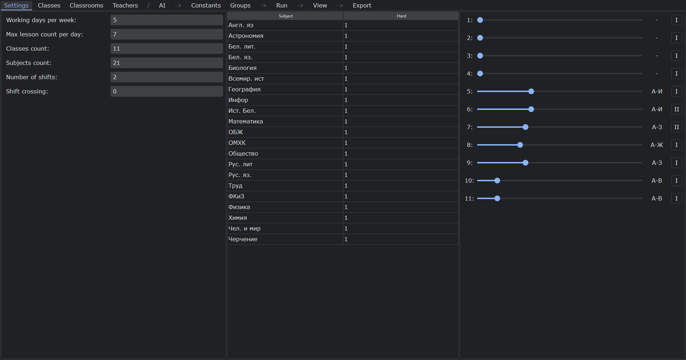

# SuperZavych - Schedule Generator

**SuperZavych** is a digital assistant for automatic schedule generation. It helps educational process organizers create timetables while taking into account teacher workloads, classroom availability, subject difficulty, shifts, groups, and other scheduling requirements.

- **Repository**: https://github.com/artyom7774/Schedule
- **Site**: https://superzavych.pythonanywhere.com/
- **Habr**: https://habr.com/ru/articles/1089006/

## Features

SuperZavych supports the full scheduling workflow, from entering school data to reviewing and exporting a timetable:

- **Flexible configuration** — set the number of school days, lessons per day, parallel classes, subjects, and shifts.
- **Class management** — define the weekly subject load for each class.
- **Classroom management** — create classroom groups and add classrooms to them.
- **Teacher setup** — assign subjects and classes to teachers and specify when they are available.
- **Subject compatibility** — define which subjects may be scheduled on the same day.
- **Groups and profiles** — split classes into groups and assign subjects to each group.
- **Fixed lessons** — reserve specific class and time slots before generation.
- **AI assistant** — ask questions, process uploaded files, and import data into the project.
- **Automatic generation** — generate a timetable using simulated annealing on a graph.
- **Viewing and editing** — review the generated timetable by class or teacher in one menu; add, remove, move, and swap lessons; rerun the algorithm on selected cells.
- **Export** — export schedules by class or teacher to `.xlsx` or `.html`.

## Installation

1. Download the latest release from the [Releases](https://github.com/artyom7774/Schedule/releases) section.
2. Run the application.
3. Enter the initial data in the recommended order: **Settings** > **Classes** > **Classrooms** > **Subjects** > **Teachers**.
4. If needed, use **AI** to import data, then configure **Constants** and **Groups**.
5. Open **Run**, check the warnings, and start generation.
6. Review and refine the result in **Edit**, then export it.

> Detailed documentation is available at [https://superzavych.pythonanywhere.com/](https://superzavych.pythonanywhere.com/).

## Quick Start

1. Install and run the application.
2. Configure the school week, classes, classrooms, subjects, and teachers.
3. Add fixed lessons or groups if your school needs them.
4. Click **Run** and wait for the timetable to be generated.
5. Review and edit the result, then export it.

## Program Structure

The interface is organized into **11 menus**. Work proceeds from initial configuration to timetable generation and export.

| Stage                | Menus                                                      | Purpose                                                                        |
|----------------------|------------------------------------------------------------|--------------------------------------------------------------------------------|
| **Setup**            | Settings > Classes > Classrooms > Subjects > Teachers > AI | Configure the project, enter data, and optionally import it with AI assistance |
| **Scheduling rules** | Constants > Groups                                         | Set fixed lessons and define class groups or profiles                          |
| **Results**          | Run > Edit > Export                                        | Generate, review, modify, and export the timetable                             |

### Settings

Set the basic parameters used to build the timetable: the number of school days per week, lessons per day, parallel classes, subjects, and shifts. Configure subject names and difficulty levels, the number of classes in each parallel, and the shift assigned to each parallel or class. The settings also include the number of lesson periods that overlap between shifts.

### Classes

For each class, specify how many times per week each subject should be taught. This defines the weekly subject load that the algorithm must place in the timetable.

### Classrooms

Create classroom groups and add classrooms to them. For example, a group can contain computer labs or physics rooms. These groups can later be selected as classroom preferences for a teacher's subject.

### Subjects

Use the subject compatibility table to specify whether two subjects may be scheduled on the same day. Compatible and incompatible pairs are shown with different colors, making it easier to set rules for subject combinations.

### Teachers

Add teachers and define the subjects and classes they teach. Set each teacher's available time by shift and lesson:

- **Green** marks a period when the teacher can teach.
- **Yellow** marks a period when the teacher is occupied but is not teaching; it is not counted as a gap in the teacher's schedule.

For each subject, select the classes the teacher teaches and set the priority of classroom groups. You can also specify that a subject does not require a classroom.

### AI Assistant

Chat with the assistant, ask questions about the project or uploaded files, and request data import into the project. The assistant can help reduce manual data entry.

Supported formats include `.sqlite`, `.sqlite3`, `.xlsx`, `.xls`, `.txt`, `.csv`, `.json`, `.md`, `.html`, `.xml`, `.pdf`, and `.docx`.

### Constants

Reserve a lesson for a particular class at a particular time before generation. Constants can be used for homeroom periods, meetings, events, or other fixed requirements. When groups are configured, a time slot can contain lessons for multiple groups.

### Groups

Split a class into subgroups or profiles and assign subjects to each group. This makes it possible to schedule group-specific lessons and support profile classes or individual study plans.

### Run

Start timetable generation and configure the scoring multipliers used by the algorithm. Before generation, the program checks the project data and displays warnings about detected errors or inconsistencies.

The algorithm then searches for a timetable with a lower weighted score. You can adjust criterion multipliers to prioritize different scheduling preferences.

### Edit

Review and refine the generated timetable. Switch between viewing it by class or by teacher to inspect the result from the perspective of both students and staff. Cells with conflicts are highlighted, and the pool of lessons still to be placed is shown next to the timetable.
You can make targeted changes: add or remove lessons, move or swap them, and rerun the algorithm only for selected cells. This allows you to refine part of the schedule without regenerating the entire timetable.

### Export

Set the start and end time for each lesson in each shift. Export the timetable by class or by teacher to `.xlsx`, or export it as a single-page `.html` site.

## Algorithm

The generation algorithm is based on **simulated annealing on a graph**. Each candidate timetable is scored using weighted criteria, and the algorithm aims to minimize the total score. Penalties add points; bonuses reduce the score.

### Scoring criteria

| Criterion                      | Description                                                                                                                |
|--------------------------------|----------------------------------------------------------------------------------------------------------------------------|
| **Repeated lessons**           | Penalty for scheduling the same subject two or more times for a class on the same day.                                     |
| **Uneven daily class load**    | Penalty when the number of lessons in a class varies unevenly across days, taking the configured daily limit into account. |
| **Gaps in class schedule**     | Penalty for each empty period between lessons in a class's daily schedule.                                                 |
| **Difficulty distribution**    | Penalty for distributing subject difficulty unevenly across the school week.                                               |
| **Teacher free time**          | Penalty for each gap between a teacher's lessons.                                                                          |
| **Short teacher day**          | Penalty for a teacher's day with fewer than five lessons.                                                                  |
| **Group bonus**                | Score reduction for scheduling lessons for multiple groups in the same time slot.                                          |
| **Shift lesson overlaps**      | Penalty for overlapping lessons in a teacher's schedule across shifts.                                                     |
| **Classroom priority**         | Penalty for assigning a classroom group below the teacher's preferred priority.                                            |
| **Gaps in groups**             | Penalty when a group has no lesson in a period but has another lesson later that day.                                      |
| **Teacher daily lesson limit** | Penalty for lessons scheduled above the teacher's configured daily lesson limit.                                           |

## License

This project is licensed under the **GPLv3**.
